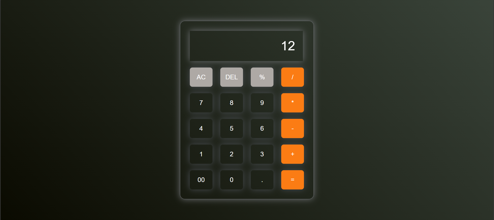

🧮 Calculator

  <strong>Modern Calculator Project</strong>

  An Advanced Calculator built using HTML, CSS, and JavaScript, featuring smooth Calculations, colorful Arithmetic Operations, and a modern dark UI with Orange Buttons design.

⸻

🖼️ Project Preview

  

⸻

✨ Features
• 🖤 Features a minimalist, dark neumorphic layout with soft glow accents.
• 🍊 Highlights action operators (/, *, -, +, =) in a vibrant orange column.
• 🔢 Details a clean grid of readable numbers (0-9, 00) and function keys.
• 🖥️ Showcases a simple, crisp digital display currently showing the number 12.
• ✨ Ideal visual inspiration for creators looking to design a sleek, user-friendly mobile interface.

⸻

🛠️ Technologies Used

  
  
  

⸻

🚀 How to Run

1. Clone this repository.
2. Open the project folder.
3. Open index.html in your browser.
4. Enjoy your Calculator!

⸻

👨‍💻 Developer

NUAM

